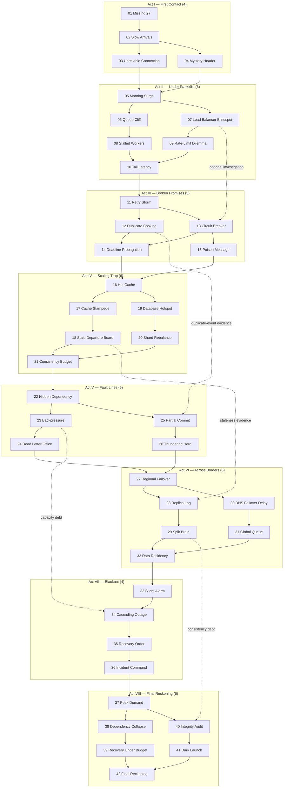

# Lost in Transit — Campaign graph and gameplay specification

## Rules

This is a **directed campaign graph**, not a fixed linear sequence. Each mission is a playable incident with a seeded workload, hidden root cause, discoverable evidence, at least two interventions, testable win conditions, and a debrief. Nodes are examples of designed content until implemented and browser-tested. Never label placeholders playable.

- 42 mission nodes across eight acts (4 + 6 + 5 + 6 + 5 + 6 + 4 + 6 = 42).
- A normal run plays a subset, not all 42. Some paths branch exclusively, others reconverge, and optional forensic missions may be revisited.
- Unlock edges are prerequisites; guards also depend on persistent architecture state, evidence found, outcomes and budget.
- No mission advertises its root cause. Expose symptoms and evidence through player actions.
- Allow recovery from suboptimal designs, at a meaningful cost. Avoid permanent soft-locks.

## Graph

## Architectural decisions and guard examples

- After Act II, player chooses concrete capacity/routing/retry settings **without labels such as 'safe route' or 'risky route'**. These alter workload outcomes.
- C02 unlocks only if the campaign has seen at-least-once delivery or retry duplication; otherwise C03 remains reachable. Players can later discover C02 via forensic evidence.
- D03 unlocks after enabling caching; D04 after selecting no cache, discovering a hotspot, or performing an audit. D06 is reachable through either track.
- F03 unlocks when replicas can accept concurrent writes; F04 when DNS-based failover is configured. Every run still reaches F06 through at least one path.
- Optional dotted connections represent additional evidence, remedial opportunities or bonus node access, not a required shortcut through acts.
- Endings evaluate actually recorded resilience, performance, integrity, operational cost and incident response across the final test workload. Provide at least six ending categories, with at least two fully reachable in first shipped slice. Do not imply unfinished endings are playable.

## Required schema per mission

`id`, `act`, `title`, `short_hook`, `prerequisites`, `unlock_guards`, `exclusive_group?`, `starting_architecture_delta`, `workload_seed`, `workload`, `hidden_fault_model`, `initial_observables`, `discoverable_evidence`, `diagnostic_actions`, `interventions`, `simulator_assertions`, `completion_conditions`, `failure_conditions`, `persistent_consequences`, `skills_tested`, `debrief`, `replay_variants`.

## Suggested first playable slice

Implement and thoroughly test A01–A04, B01–B03, C01–C03, D01–D02, plus an initial converging challenge and two genuinely reachable endings. This is an implementation priority, not a claim that the remaining nodes work. If the simulation needs narrower scope, prioritize a smaller coherent branching vertical slice over shallow breadth.

## Acceptance

- Every playable node has more than one plausible intervention and evidence sufficient to distinguish causes.
- At least three strategic paths that change state and later workloads, not merely dialogue or colors.
- Players can inspect a topology and traces but cannot identify failure by looking for an obvious red node.
- Graph validation checks reachability, non-contradictory guards, absence of unintended soft-locks, and legitimate ending routes.
- Campaign save, new-game, restart, replay, and return-to-map controls work.
